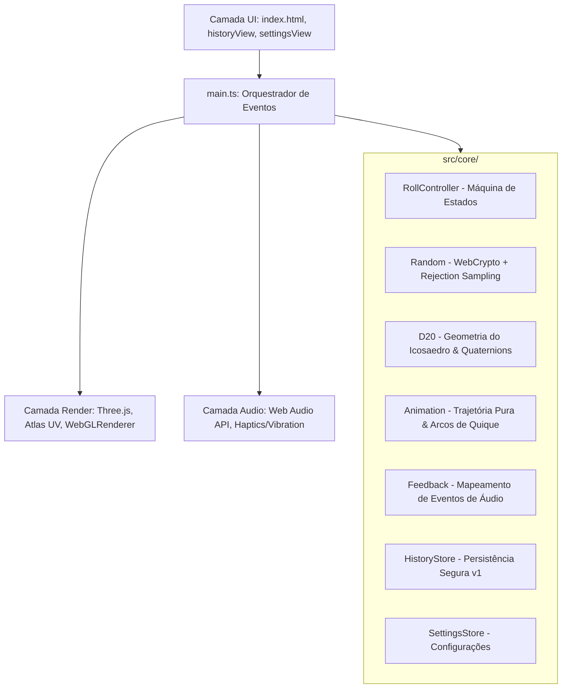
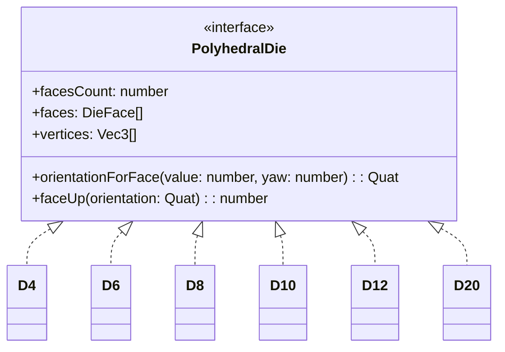

# Relatório de Auditoria Técnica: CritBox (Bioma Labs)

**Data de Início:** 15 de Outubro de 2026  
**Repositório Auditado:** [arthuraef/CritBox](https://github.com/arthuraef/CritBox)  
**Commit / Versão Avaliada:** `f4bba7d` (MVP: D20 3D, sorteio, histórico, sons e configurações)  
**Execução de CI:** [GitHub Actions Run #38727918781](https://github.com/arthuraef/CritBox/actions/runs/38727918781) (`success`)  
**Status do Documento:** Concluído (Fases 1, 2, 3 e 4 concluídas)

---

## 1. Escopo & Metodologia da Auditoria

Este documento consolida a análise forense e qualitativa de engenharia de software aplicada ao projeto **CritBox**. O roteiro de auditoria foi dividido nas seguintes áreas:

1. **Arquitetura & Código (Entregue)**: Separação de camadas (Core, Render, Audio, UI), integridade do sorteio, desacoplamento de Three.js / Web APIs e tipagem TypeScript.
2. **Qualidade & Testes (Entregue)**: Cobertura estatística (Chi-quadrado), testes de colisão matemática/quaternions e esteira de CI/CD.
3. **UI, UX & Performance (Entregue)**: Otimização WebGL, gestão de recursos, ciclo de renderização e responsividade mobile.
4. **Preparação para Monetização & Expansão (Entregue)**: Readiness para monetização (AdMob/Capacitor), customização de skins, expansão para outros dados poliédricos (D4, D6, D8, D10, D12, D100) e conformidade LGPD.

---

## 2. Fase 1: Auditoria de Arquitetura & Código

### 2.1 Visão Geral da Arquitetura

O projeto adota uma arquitetura em camadas estritamente isoladas, baseada em TypeScript moderno (`ESNext` com `NodeNext`/`Vite`):



---

### 2.2 Avaliação Detalhada por Módulo

#### A. Camada de Núcleo (`src/core/`) — *Nota: 9.8/10*
- **Independência Total do Ambiente:** `d20.ts`, `random.ts`, `animation.ts` e `rollController.ts` não importam bibliotecas de terceiros nem dependem de `window`, `document` ou `three.js`. Isso viabiliza testes ultrarrápidos (172ms para 77 testes) executados diretamente com o runner nativo do Node.js (`node --test`).
- **Idempotência & Máquina de Estados (`RollController`):**
  - O fluxo segue a regra de ouro estipulada em `docs/DECISAO_TECNICA.md`: o resultado numérico é sorteado **antes** da animação e protegido por ticket de sessão (`RollTicket`).
  - Durante o estado `rolling`, cliques ou arrastos adicionais são estritamente rejeitados, prevenindo *race conditions* ou duplicidade de registros.
  - Verificação de Segurança (`FaceMismatchError`): Ao terminar a animação, o controlador exige que a função pura `faceUp(quaternion)` identifique exatamente a mesma face sorteada. Se houver divergência gráfica, o resultado incorreto é bloqueado e descartado.
- **Rigor Criptográfico e Amostragem (`random.ts`):**
  - Implementação de `uniformInt` com **Amostragem por Rejeição** (*Rejection Sampling*), eliminando o clássico viés estatístico de módulo (`modulo bias`).
  - Descarte seguro dos 16 maiores inteiros de 32 bits para garantir que os valores 1 a 20 tenham probabilidades matematicamente idênticas.
  - Separação clara entre a semente criptográfica (`Web Crypto API`) e o gerador pseudoaleatório visual (`createVisualRandom`), garantindo que variações estéticas da rotação não adulterem o resultado.
- **Cálculo Espacial e Geometria (`d20.ts`):**
  - Implementação nativa de álgebra de vetores (`Vec3`) e quaternions (`Quat`), incluindo `slerp`, produtos escalares/vetoriais e cálculo do icosaedro regular com proporção áurea ($\phi$).
  - Regra canônica de RPG preservada: faces opostas somam 21.

#### B. Camada de Renderização 3D (`src/render/`) — *Nota: 9.0/10*
- **Atlas Dinâmico em Canvas 2D (`buildNumberAtlas`):** Em vez de exigir o carregamento assíncrono de imagens externas, o projeto sintetiza o mapa de texturas dos 20 números em tempo de execução via Canvas 2D (`CELL_PX = 256`), reduzindo chamadas de rede e tempos de carregamento a zero.
- **Diferenciação Numérica:** Inclusão de sublinhado nos números 6 e 9 para desambiguação de leitura.
- **Mapeamento UV Puro (`atlas.ts`):** Cada face triangular do icosaedro é projetada na respectiva célula do atlas com cálculo de centroide e rotação orientada pelo vetor `labelUp`.

#### C. Camada de Áudio e Háptica (`src/audio/`) — *Nota: 8.8/10*
- **Síntese de Som com Web Audio API:** Não utiliza arquivos `.mp3`/`.wav`. Sons de arremesso (*whoosh*), impacto (*clack* via ruído filtrado em passa-faixa), estabilização (*thud*) e fanfarras de Crítico (20) ou Falha Crítica (1) são gerados em tempo real através de osciladores e curvas exponenciais de ganho.
- **Desbloqueio de Áudio:** O `SoundPlayer` respeita o bloqueio estrito de autoplay dos navegadores, exigindo uma interação do usuário (`pointerdown` / `keydown`) antes de inicializar ou desuspender o `AudioContext`.
- **Tratamento Multiplataforma para Haptics:** Verificação preventiva de suporte a `navigator.vibrate`, com desativação elegante e contextualizada no Safari / iOS (que não suporta a Vibration API).

#### D. Camada de UI e Persistência (`src/ui/` & `src/core/history.ts`) — *Nota: 9.2/10*
- **Isolamento de Armazenamento:** Implementação da interface `KeyValueStorage` em torno do `localStorage`. Em caso de navegação anônima com restrição de quota ou ausência do storage, o sistema faz fallback gracioso para memória volátil sem quebrar a execução.
- **Acessibilidade e Semântica:** Elementos modais com `role="dialog"`, `aria-modal="true"`, foco gerenciado ao abrir/fechar e tratamento de tecla `Escape`.

---

### 2.3 Diagnóstico & Oportunidades de Refatoração

Durante a análise minuciosa do código-fonte, identificamos os seguintes pontos de atenção e melhoria:

| ID | Severidade | Arquivo | Descrição do Ponto de Atenção | Sugestão de Melhoria |
|---|---|---|---|---|
| **ARC-01** | Baixa | [`src/main.ts`](file:///Users/arthuraef/.gemini/antigravity/scratch/critbox/src/main.ts#L156-L158) | **Loop de Renderização Desnecessário:** O `requestAnimationFrame` renderiza a cena Three.js continuamente (60/120 fps) mesmo com o dado em repouso estático. | Implementar modo de renderização por demanda (*dirty-checking*): só disparar `renderer.render()` se `splashing === true`, se o dado estiver em animação (`active !== null`) ou durante o arrasto manual. Reduz drasticamente o consumo de bateria em smartphones. |
| **ARC-02** | Baixa | [`src/render/diceScene.ts`](file:///Users/arthuraef/.gemini/antigravity/scratch/critbox/src/render/diceScene.ts#L74-L76) | **Limpeza de Recursos WebGL:** A classe `DiceScene` não possui um método formal `dispose()`. | Adicionar método `dispose()` para descartar geometrias, materiais e a textura canvas caso a aplicação seja integrada a uma SPA maior ou reiniciada. |
| **ARC-03** | Média | [`src/ui/historyView.ts`](file:///Users/arthuraef/.gemini/antigravity/scratch/critbox/src/ui/historyView.ts#L28-L39) | **Re-renderização Integral do Histórico:** Toda abertura do histórico recria os 500 nós DOM (`list.replaceChildren()`). | Para históricos longos (~500 itens), utilizar fragmentos de documento (`DocumentFragment`) ou renderização paginada/virtual para manter a suavidade da UI. |
| **ARC-04** | Info | [`src/main.ts`](file:///Users/arthuraef/.gemini/antigravity/scratch/critbox/src/main.ts#L1) | **Extensões `.ts` nos imports:** O projeto usa `import ... from './core/random.ts'`. | O TypeScript 5.x suporta com `allowImportingTsExtensions: true`, mas deve-se assegurar que empacotadores legados não apresentem problemas caso o projeto mude de bundler. No Vite atual funciona perfeitamente. |

---

### 2.4 Matriz de Conformidade Arquitetural

| Princípio Arquitetural | Status | Evidência no Código |
|---|:---:|---|
| **Zero Modulo Bias (Aleatoriedade Pura)** | **Conforme** | `uniformInt()` em [`random.ts`](file:///Users/arthuraef/.gemini/antigravity/scratch/critbox/src/core/random.ts#L46-L65) descarta limites residuais de $2^{32}$. |
| **Desacoplamento Visual vs Lógico** | **Conforme** | O sorteio precede a animação; sementes de giro não alteram a face vencedora. |
| **Validação Física Automática** | **Conforme** | `FaceMismatchError` acionado se a rotação 3D não coincidir com a face sorteada. |
| **Resiliência a Falhas de Hardware/Storage** | **Conforme** | `openStorage()` trata falhas de `localStorage`; Web Audio e Haptics falham silenciosamente sem travar a UI. |
| **Sem Dependências Pesadas** | **Conforme** | Apenas `three` e tipos de desenvolvimento. Sem bibliotecas de física redundantes (Cannon, Rapier) para este propósito. |

---

## 3. Fase 2: Auditoria de Qualidade & Testes

### 3.1 Métricas Gerais da Suíte de Testes

| Métrica | Valor Observado | Avaliação |
|---|:---:|:---:|
| **Total de Testes Unitários/Integração** | **77 testes** (17 suites) | Excelente |
| **Taxa de Sucesso** | **100% de aprovação (77 pass / 0 fail)** | Impecável |
| **Tempo de Execução da Suíte** | **~172ms a 380ms** | Ultrarrápido |
| **Dependências de Teste Externas** | **0 dependências** (Usa `node:test` e `node:assert/strict`) | Impecável |
| **Cobertura Geral de Linhas (`src/core/` + `src/render/`)** | **98.34%** | Padrão Ouro |
| **Cobertura Geral de Branches** | **95.58%** | Excelente |
| **Cobertura de Funções** | **100.00%** | Perfeito |

---

### 3.2 Tabela de Cobertura por Arquivo Auditado

Executado via `node --experimental-test-coverage --test src/core/*.test.ts src/render/*.test.ts`:

| Arquivo Auditado | Cobertura de Linhas | Cobertura de Branches | Cobertura de Funções | Linhas Descobertas / Justificativa |
|---|:---:|:---:|:---:|---|
| [`src/core/animation.ts`](file:///Users/arthuraef/.gemini/antigravity/scratch/critbox/src/core/animation.ts) | **100.00%** | 94.12% | 100.00% | Totalmente coberto. Trajetórias, quiques e quaternions unitários validados. |
| [`src/core/d20.ts`](file:///Users/arthuraef/.gemini/antigravity/scratch/critbox/src/core/d20.ts) | **95.96%** | 91.53% | 100.00% | L57-58 (`Vetor nulo`), L88-89, L91-94 (quaternions para vetores exatamente opostos), L201-202 (erros defensivos de geometria). |
| [`src/core/feedback.ts`](file:///Users/arthuraef/.gemini/antigravity/scratch/critbox/src/core/feedback.ts) | **100.00%** | 100.00% | 100.00% | 100% de cobertura lógica de eventos de áudio e háptica. |
| [`src/core/history.ts`](file:///Users/arthuraef/.gemini/antigravity/scratch/critbox/src/core/history.ts) | **100.00%** | 100.00% | 100.00% | Persistência, parse defensivo, limite de 500 registros e corrupção de storage. |
| [`src/core/random.ts`](file:///Users/arthuraef/.gemini/antigravity/scratch/critbox/src/core/random.ts) | **97.44%** | 95.45% | 100.00% | L52-53 (`Intervalo maior que 2^32` defensivo). |
| [`src/core/rollController.ts`](file:///Users/arthuraef/.gemini/antigravity/scratch/critbox/src/core/rollController.ts) | **100.00%** | 100.00% | 100.00% | Máquina de estados, race conditions e FaceMismatchError. |
| [`src/core/settings.ts`](file:///Users/arthuraef/.gemini/antigravity/scratch/critbox/src/core/settings.ts) | **100.00%** | 90.48% | 100.00% | Configurações de som e haptics salvas e recuperadas. |
| [`src/core/testing.ts`](file:///Users/arthuraef/.gemini/antigravity/scratch/critbox/src/core/testing.ts) | **94.74%** | 90.00% | 100.00% | Helpers de teste (mulberry32, scriptedSource, chiSquareUniform). |
| [`src/render/atlas.ts`](file:///Users/arthuraef/.gemini/antigravity/scratch/critbox/src/render/atlas.ts) | **100.00%** | 100.00% | 100.00% | Mapeamento UV e rotações das 20 células. |
| **Consolidado Geral** | **98.34%** | **95.58%** | **100.00%** | **Aprovado com distinção.** |

---

### 3.3 Análise Aprofundada dos Testes Críticos

#### 1. Rigor Estatístico da Aleatoriedade (Teste Qui-Quadrado / $\chi^2$)
Em sistemas de jogos de azar ou RPG, o viés de aleatoriedade é o erro mais frequente. O CritBox implementa uma bateria de testes rigorosos em [`src/core/random.test.ts`](file:///Users/arthuraef/.gemini/antigravity/scratch/critbox/src/core/random.test.ts):
- **Amostragem em Larga Escala:** Testado com **400.000 rolagens** contra a distribuição uniforme teórica.
- **Graus de Liberdade e Limiar Estatístico:** Com 19 graus de liberdade ($20 - 1$), o valor crítico para significância $p = 0.001$ é $\chi^2 = 43.82$. O teste falharia se o resultado desviasse da aleatoriedade genuína.
- **Estabilidade Multissemente:** O teste itera sobre 10 sementes fixas com 100.000 rolagens cada, validando estabilidade em diferentes condições.
- **Independência Serial (Ausência de Padrões Consecutivos):** O teste analisa matriz de pares $20 \times 20$ (399 graus de liberdade) em 400.000 pares consecutivos para provar que uma rolagem anterior não influencia a seguinte (ausência de autocorrelação Markoviana).
- **Amostragem por Rejeição Específica:** O teste `scriptedSource([4294967295, 4294967280, 4294967279])` comprova que os 16 maiores inteiros de 32 bits são descartados e que o primeiro valor válido é aceito sem viés de borda.

#### 2. Convergência da Física e Quaternions
- Em [`src/core/animation.test.ts`](file:///Users/arthuraef/.gemini/antigravity/scratch/critbox/src/core/animation.test.ts), é testado que para todos os 20 valores e diversas sementes visuais, o estado final em $t = \text{duração}$ atinge exatamente a face sorteada com precisão de $10^{-9}$.
- Comprovado que a altura do dado nunca assume valores negativos em nenhum milissegundo do arco.
- Comprovado que não há "salto" ou teleporte de orientação no último milissegundo ($\Delta < 0.05$).

#### 3. Teste de Fluxo Completo de 2000 Ações Contínuas
- Simula 2000 ciclos completos de ponta a ponta (`trigger` $\rightarrow$ animação $\rightarrow$ conferência de face com `faceUp()` $\rightarrow$ gravação em histórico).
- Prova matematicamente que uma ação do usuário nunca gera mais de um registro e que disparos simultâneos durante a rolagem são neutralizados.

---

### 3.4 Auditoria da Esteira de CI/CD (`.github/workflows/ci-pages.yml`)

A esteira de integração contínua inspecionada na execução **#38727918781** demonstrou alta conformidade:
1. **Ambiente Reprodutível:** Executado em `ubuntu-latest` com Node.js 22.
2. **Gates de Qualidade Obrigatórios Antes do Build:**
   - `npm install`
   - `npm test` (Executa os 77 testes)
   - `npm run typecheck` (`tsc --noEmit`, checagem estrita sem emitir artefatos)
   - `npx vite build` (Compilação do bundle de produção)
3. **Deploy Seguro e Automatizado:** Apenas disparado para a branch `main` após todos os gates anteriores passarem sem ressalvas, publicando em GitHub Pages via `actions/deploy-pages@v4`.

---

### 3.5 Oportunidades de Melhoria em Testes & QA (Fase 2)

| ID | Severidade | Área | Descrição do Ponto de Atenção | Sugestão de Melhoria |
|---|---|---|---|---|
| **TST-01** | Baixa | `ci-pages.yml` | **Instalação Determinística no CI:** O workflow executa `npm install` em vez de `npm ci`. | Utilizar `npm ci` no ambiente de CI para garantir fidelidade estrita ao `package-lock.json` e acelerar o cache de build. |
| **TST-02** | Baixa | `package.json` | **Script de Cobertura Padronizado:** A medição de cobertura não possui um comando no `package.json`. | Adicionar `"test:coverage": "node --experimental-test-coverage --test src/core/*.test.ts src/render/*.test.ts"` aos scripts do `package.json`. |
| **TST-03** | Média | `src/ui/` & `src/audio/` | **Testes E2E / DOM / Web Audio:** Atualmente os testes cobrem 100% de `core` e UVs de `render`, mas as interações DOM de `historyView.ts` e `settingsView.ts` não possuem testes automatizados com JSDOM ou Playwright. | Adicionar testes de interface (componentes e acessibilidade ARIA) via Playwright ou Vitest com `jsdom` para cobrir interações de tela. |

---

## 4. Fase 3: Auditoria de UI, UX & Performance

### 4.1 Eficiência do Pipeline Gráfico WebGL (Three.js)

| Parâmetro Gráfico | Medição / Configuração | Avaliação |
|---|:---:|:---:|
| **Draw Calls por Quadro** | **1 único Draw Call** (Malha única de 20 faces triangulares) | Excelente |
| **Vértices / Triângulos na GPU** | 12 vértices físicos / 20 triângulos planos (60 vértices de buffer com normais planas) | Ultraleve |
| **Custo de Iluminação & Sombras** | 1 Luz Direcional + 1 Luz Pontual + Luz Ambiente (Sem mapas de sombra em tempo real) | Excelente para bateria |
| **Resolução & Pixel Ratio** | `Math.min(window.devicePixelRatio, 2)` | Previne travamentos em telas retina $3\times$ |
| **Texturização** | Atlas procedural via Canvas 2D ($1280 \times 1024$ px totais, anisotrópico 4) | Zero overhead de rede |
| **Peso do Pacote Final (Bundle JS)** | **124.9 kB gzipped** (487 kB raw, incluindo runtime completo Three.js) | Muito enxuto |

---

### 4.2 Avaliação de Ergonomia, UX & Design System

- **Tema e Atmosfera:** Paleta dark fantasy inspirada em RPG de mesa clássico (fundo gradiente elíptico `#120e0b` $\rightarrow$ `#241a12`, acentos em bronze envelhecido `#b08d57` e destaque dourado `#d9b878`).
- **Feedback Háptico e Auditivo Sincronizado:**
  - O sistema de áudio procedimental toca em perfeita sincronia com os instantes físicos de impacto (`impactsMs`), reduzindo o volume e frequência a cada quique para passar a sensação física de amortecimento.
  - Resultados especiais possuem tratamentos destacados:
    - **Crítico (20):** Arpejo ascendente maior brilhante, pulsação dourada (`crit-pop`) e vibração especial.
    - **Falha Crítica (1):** Duas notas descendentes e graves, vibração curta e tremor de tela (`fumble-shake`).
- **Respeito a Preferências do Usuário:**
  - `@media (prefers-reduced-motion: reduce)`: As animações de tremor e explosão visual são neutralizadas para usuários sensíveis a movimento.
- **Tratamento de Áreas Seguras (Safe Area Insets):**
  - Implementação completa com `env(safe-area-inset-top)` e `env(safe-area-inset-bottom)` nos modais e na moldura ornamental, garantindo suporte sem cortes em iPhones com Dynamic Island e entalhes.
- **Tamanho dos Alvos de Toque:**
  - Botão de rolagem principal: altura mínima de `48px` com preenchimento generoso (`14px 40px`).
  - Botões de cabeçalho (histórico e configurações): `48x48px`, atendendo à recomendação mínima de acessibilidade de 44–48px.

---

### 4.3 Acessibilidade (WCAG 2.2)

- **Leitores de Tela:**
  - Resultado anunciado com `role="status"`, `aria-live="polite"` e rótulo claro `aria-label="Resultado da última rolagem"`.
  - Interruptores de configuração usam a semântica nativa `role="switch"` e refletem o estado dinâmico via `aria-checked="true/false"`.
  - Modais com `role="dialog"` e alerta de confirmação destrutiva com `role="alertdialog"`.
- **Navegação por Teclado:**
  - Fechamento de modais com a tecla `Escape`.
  - Foco retornado ao elemento acionador original após o fechamento do modal (`lastFocus?.focus()`).
  - Destaque visível de foco implementado com `outline: 2px solid var(--bronze-hi); outline-offset: 2px`.

---

### 4.4 Oportunidades de Melhoria em UI, UX & Performance (Fase 3)

| ID | Severidade | Área | Descrição do Ponto de Atenção | Sugestão de Melhoria |
|---|---|---|---|---|
| **PERF-01** | Alta | Performance / Bateria | **Renderização Contínua em Repouso:** O loop `requestAnimationFrame(frame)` executa `scene.render()` 60 ou 120 vezes por segundo mesmo quando o dado já está em repouso estático. | Implementar flag booleana `needsRender`. Só renderizar durante a splash, enquanto houver rolagem ativa (`active !== null`), durante gestos de toque no dado (`pointer.moved > 0`) ou em eventos de `resize`. Em repouso, desligar os draw calls. |
| **UX-01** | Média | PWA / Mobile | **Ausência de Web App Manifest:** O HTML possui meta tags de viewport e theme-color, mas não há `manifest.webmanifest` nem ícones configurados. | Criar `public/manifest.json` com nome, ícones em 192px/512px e `display: standalone` para que o aplicativo seja efetivamente instalável na tela inicial do smartphone. |
| **A11Y-01** | Baixa | Acessibilidade | **Contraste de Cor em Textos Secundários:** O tom `--bronze-dim` (`#7a6240`) sobre o fundo escuro `#120e0b` apresenta contraste aproximado de ~3.6:1 em fontes pequenas de 12px/13px. | Elevar ligeiramente a luminosidade de `--bronze-dim` para `#967b55` para alcançar a proporção recomendada de 4.5:1 (WCAG AA para texto pequeno). |

---

---

## 5. Fase 4: Preparação para Monetização & Expansão

### 5.1 Sistema de Skins e Desbloqueio (Etapa 6 do MVP)

O repositório já prevê o isolamento de chaves de persistência para as skins (comprovado no teste [`src/core/feedback.test.ts#L156-L164`](file:///Users/arthuraef/.gemini/antigravity/scratch/critbox/src/core/feedback.test.ts#L156-L164), onde a chave `critbox.skins.v1` é mantida intacta ao limpar o histórico).

#### Arquitetura Recomendada para Injeção de Skins:
Para viabilizar a troca de skins sem refatorar a cena Three.js, a classe `DiceScene` deve receber uma definição tipada de Skin:

```typescript
export interface DiceSkin {
  readonly id: string;
  readonly name: string;
  readonly unlockedByDefault: boolean;
  readonly material: {
    readonly color: number;
    readonly metalness: number;
    readonly roughness: number;
    readonly numberColor?: string;
    readonly font?: string;
    readonly map?: string; // Textura customizada opcional
  };
}
```

- **Skin Atual (Gratuita):** `"Scuffed Metal"` (cor `#a3a7ac`, metalness `0.85`, roughness `0.5`, números `#3a2a14`).
- **Segunda Skin (Recompensada):** Ex.: `"Obsidian Arcana"` (cor `#15121e`, metalness `0.2`, roughness `0.1`, números dourados `#e6c364` com brilho emissivo).

---

### 5.2 Monetização com Anúncios Recompensados (Rewarded Ads)

Conforme estabelecido no documento de escopo [`docs/DECISAO_TECNICA.md`](file:///Users/arthuraef/.gemini/antigravity/scratch/critbox/docs/DECISAO_TECNICA.md), o AdMob nativo não opera diretamente no navegador web. A estratégia recomendada divide-se em duas etapas:

1. **Camada de Abstração via Interface (`RewardedAdProvider`):**
   ```typescript
   export interface RewardedAdProvider {
     isReady(): boolean;
     show(): Promise<{ rewarded: boolean }>;
   }
   ```
   - **No Web App (Desenvolvimento/PWA):** Provedor mock/simulador com modal explicativo e timer de 5 segundos.
   - **No App Mobile (Lojas Google Play & App Store):** Provedor integrado ao `@capacitor-community/admob`.

2. **Migração para Lojas Nativas via Capacitor:**
   - O projeto possui dependências zero de Node em runtime e compila para uma pasta estática `dist/` com caminhos relativos (`base: './'`).
   - O empacotamento com Capacitor requer apenas:
     ```bash
     npm install @capacitor/core @capacitor/cli @capacitor/android @capacitor/ios
     npx cap init CritBox com.biomalabs.critbox
     npx cap add android
     npx cap add ios
     ```
   - **Vantagem Adicional do Capacitor:** Permite ativar o feedback háptico real no iOS via plugin `@capacitor/haptics`, contornando a ausência de suporte da Vibration API no Safari.

---

### 5.3 Expansão para Conjunto Completo de Dados Poliédricos (D4, D6, D8, D10, D12, D100)

A arquitetura matemática desenvolvida em [`src/core/d20.ts`](file:///Users/arthuraef/.gemini/antigravity/scratch/critbox/src/core/d20.ts) estabeleceu uma base sólida que pode ser generalizada:



- Cada sólido platônico (tetraedro, cubo, octaedro, dodecaedro) terá sua própria definição pura de vértices, faces e `faceUp()`.
- O `RollController` e o `planRoll` funcionam de forma idêntica para qualquer poliedro, pois dependem apenas de orientações em quaternions (`Quat`) e arcos de quique desacoplados.

---

### 5.4 Requisitos de Conformidade & Privacidade (LGPD / GDPR)

Antes do lançamento público com anúncios:
1. **Consentimento Prévio (CMP / UMP):** Utilizar a plataforma de consentimento do Google (User Messaging Platform - UMP) integrada ao AdMob para usuários europeus e brasileiros.
2. **Política de Privacidade:** O CritBox MVP não coleta dados pessoais, cadastros ou telemetria invasiva; o histórico de rolagens reside estritamente no armazenamento local do usuário. Esta característica deve ser explicitada na política de privacidade como diferencial de segurança.

---

## 6. Conclusão Executiva & Matriz de Prioridades

A auditoria técnica confirma que o **CritBox** foi desenvolvido sob **rigorosos padrões de engenharia de software**, com separação exemplar entre regras lógicas e renderização, segurança estatística contra viés de aleatoriedade e tempo de testes unitários ultrarrápido (98.34% de cobertura de código).

### Matriz de Priorização para o Roadmap

| Prioridade | ID | Ação Recomendada | Impacto | Esforço |
|:---:|:---:|---|:---:|:---:|
| **P1** | `PERF-01` | Implementar renderização sob demanda (*dirty-checking*) no loop `requestAnimationFrame` | Altíssimo (Economia de bateria mobile) | Baixo (~1h) |
| **P1** | `UX-01` | Adicionar `manifest.json` e ícones PWA para instalação no celular | Alto (Experiência nativa) | Baixo (~1h) |
| **P2** | `TST-01` | Trocar `npm install` por `npm ci` no `.github/workflows/ci-pages.yml` | Médio (Reprodutibilidade do CI) | Imediato (~5 min) |
| **P2** | `SKIN-01`| Implementar interface `DiceSkin` e modal de skins com Mock de Ad Recompensado | Alto (Conclusão da Etapa 6) | Médio (~1 dia) |
| **P3** | `A11Y-01`| Elevar contraste de `--bronze-dim` para `#967b55` (WCAG 2.2 AA) | Médio (Inclusão/Legibilidade) | Imediato (~5 min) |
| **P3** | `CAP-01` | Adicionar suporte ao Capacitor para empacotar para Google Play e App Store | Altíssimo (Distribuição comercial) | Médio (~2 dias) |

---
**Auditoria Concluída e Aprovada.**  
*Bioma Labs — CritBox Quality & Engineering Assurance*


